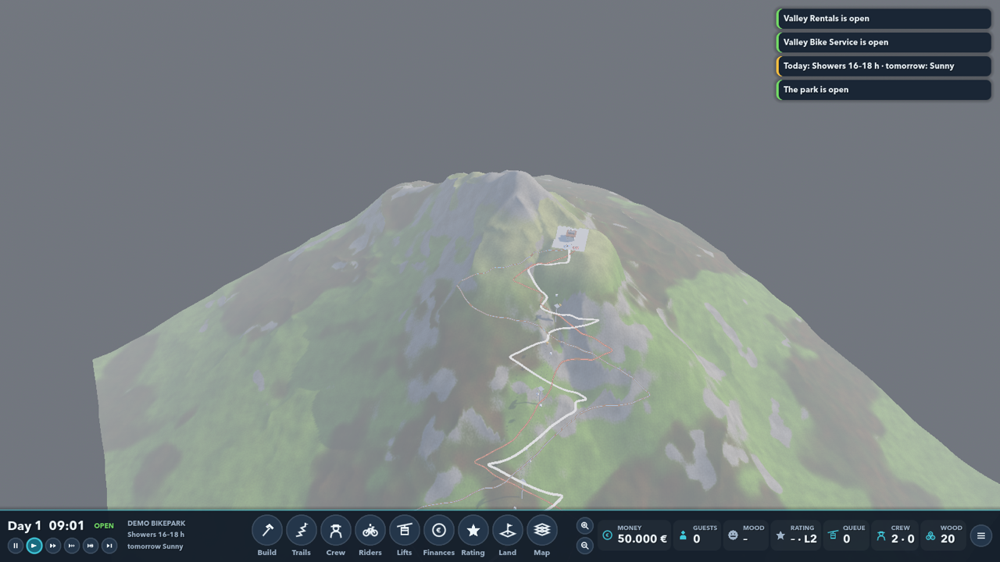

# Bikepark Manager

Build and run your own mountain bike park, RollerCoaster Tycoon style: trails, lifts, crew, bars, guests and reviews.

## Play it

Nothing to install – no Godot, no .NET.

1. Open **[Releases](https://github.com/soerenmuenker/bikepark-manager/releases/latest)** and download the zip for
   your computer: `…-Windows.zip` or `…-Mac.zip`.
2. Unzip it.
3. Start the game:
   - **Windows:** double-click `BikeparkManager.exe` (keep the `data` folder next to it).
     "Windows protected your PC"? → **More info** → **Run anyway**.
   - **Mac:** double-click `Bikepark Manager.app`.
     "can't be opened"? → **System Settings → Privacy & Security** → scroll down → **Open Anyway** (once).

**Controls:** WASD / arrows or middle-drag to move · wheel to zoom · Q/E or right-drag to rotate ·
Space pause · 1–4 speed · menus in the bottom bar · click things to open their window · Esc closes.

Careers save automatically when you quit.

## Develop

Godot 4.7 .NET (C#) on top of a pure C# simulation library. Start with [CLAUDE.md](CLAUDE.md) and
[docs/design/architecture.md](docs/design/architecture.md). **New release:** push a tag
(`git tag v0.2.0 && git push origin v0.2.0`): GitHub Actions ([release.yml](.github/workflows/release.yml)) runs the
tests, builds both zips with `tools/release/export.sh` and publishes them as a Release. The same script builds them
locally into `game/builds/` (needs the Godot 4.7.2 .NET export templates).
